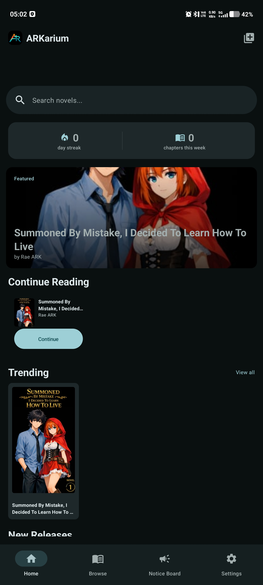
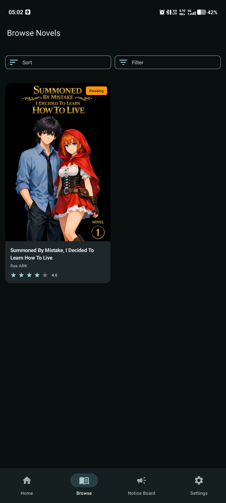
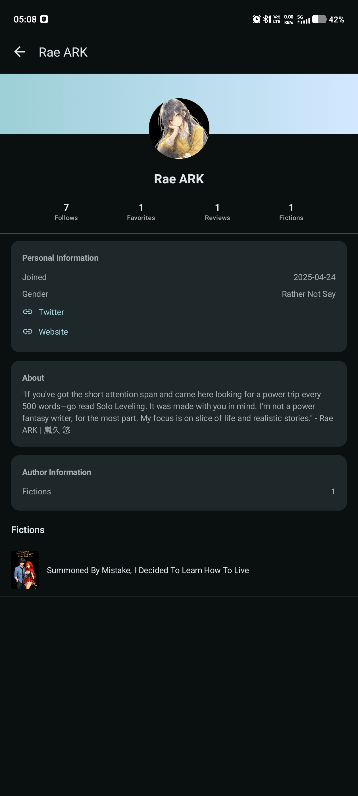
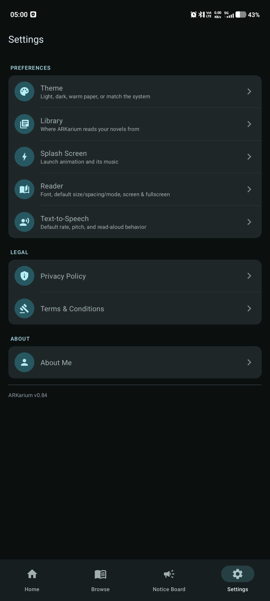

# ARKarium

A native reading experience for Rae ARK's published fiction.

[)](https://apps.obtainium.imranr.dev/redirect?r=obtainium%3A%2F%2Fapp%2F%257B%2522id%2522%253A%2522ARKarium%2522%252C%2522url%2522%253A%2522https%253A%252F%252Fgithub.com%252FRae-ARK%252FARKarium%2522%252C%2522author%2522%253A%2522Rae-ARK%2522%252C%2522name%2522%253A%2522ARKarium%2522%257D)

## What it is

ARKarium is built around direct distribution from Rae ARK to his reader.

Content is published as files in a relay and synchronized to the reader's local library. The client handles the reading experience, rather than requiring a permanent platform backend.

## Screenshots

<table>
  <tr>
    <td></td>
  </tr>
  <tr>
    <td align="center">Home</td>
  </tr>
  <tr>
    <td width="50%"></td>
    <td width="50%"></td>
  </tr>
  <tr>
    <td align="center">Browse</td>
    <td align="center">Fictions</td>
  </tr>
  <tr>
    <td width="50%"></td>
    <td width="50%"></td>
  </tr>
  <tr>
    <td align="center">Rae ARK</td>
    <td align="center">Settings</td>
  </tr>
</table>

## Highlights

- Local-first reading
- Direct Rae-ARK-to-readers distribution
- Incremental content synchronization
- Static content and simple distribution
- Android client

### At a Future Point

- Character-aware text-to-speech
- Multi-voice reading
- Designed for rich fiction experience
- Desktop Client

## Installation

ARKarium can be tracked and updated through [Obtainium](https://github.com/ImranR98/Obtainium).

Obtainium allows users to install and track Android applications directly from their source repositories, without relying on a centralized app store.

**To install:**

1. Install [Obtainium](https://github.com/ImranR98/Obtainium).
2. Click the **Get it on Obtainium** badge above.
3. Confirm the ARKarium application configuration.
4. Obtainium will track the repository for available updates.

Alternatively, add the repository manually:

https://github.com/Rae-ARK/ARKarium

## Status

Early development. Beta Stage.

The current release app itself works fine, and it can be used for reading.  
The V1 isn't done yet. Bugs are normal.

## License

Copyright © 2026 Rae-ARK. All rights reserved.

This software and its source code are proprietary.

No permission is granted to copy, modify, distribute,
sublicense, or use this software or its source code,
in whole or in part, without prior written permission
from the copyright holder.
