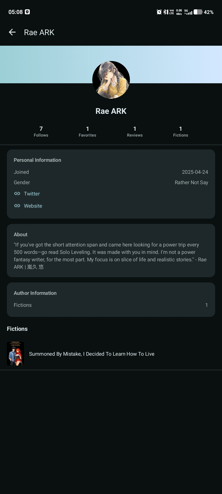

[English](../../README.md) | [简体中文](README_zh.md) | [繁體中文](README_zh-TW.md) | [日本語](README_ja.md) | [한국어](README_ko.md) | [Türkçe](README_tr.md) | [Русский](README_ru.md) | [Tiếng Việt](README_vi.md) | [ไทย](README_th.md) | [Deutsch](README_de.md) | [Español](README_es.md) | [Français](README_fr.md) | [Українська](README_uk.md) | [Polski](README_pl.md) | [Português (Brasil)](README_pt-BR.md) | [العربية](README_ar.md) | [فارسی](README_fa.md) | [Bahasa Indonesia](README_id.md) | [Italiano](README_it.md) | **Ελληνικά** | [മലയാളം](README_ml.md) | [Roman Urdu](README_ur-Latn.md) | [Română](README_ro.md) | [Български](README_bg.md) | [தமிழ்](README_ta.md)

  

<h1 align="center"><b>ARKarium</b></h1>

<h4 align="center">Μια εγγενής εμπειρία ανάγνωσης για τα δημοσιευμένα έργα μυθοπλασίας του Rae ARK.</h4>

  
  
  

<h4 align="center">
  <a href="/docs/foundational/what-is-arkarium.md">Τι είναι το ARKarium;</a> |
  <a href="/docs">Τεκμηρίωση</a> |
  <a href="/docs/foundational">Παγιωμένες Αποφάσεις</a>
</h4>

  
  

## Τι είναι

Το ARKarium είναι σχεδιασμένο γύρω από την άμεση διανομή από τον Rae ARK στον αναγνώστη του.

Το περιεχόμενο δημοσιεύεται ως αρχεία σε ένα relay και συγχρονίζεται με την τοπική βιβλιοθήκη του αναγνώστη. Ο πελάτης (client) αναλαμβάνει την εμπειρία ανάγνωσης, αντί να απαιτείται μόνιμο backend πλατφόρμας.

<b>Στιγμιότυπα οθόνης</b>

<table>
  <tr>
    <td colspan="2">
      
    </td>
  </tr>
  <tr>
    <td colspan="2" align="center">Αρχική</td>
  </tr>
  <tr>
    <td width="50%"></td>
    <td width="50%"></td>
  </tr>
  <tr>
    <td align="center">Περιήγηση</td>
    <td align="center">Έργα</td>
  </tr>
  <tr>
    <td width="50%"></td>
    <td width="50%"></td>
  </tr>
  <tr>
    <td align="center">Rae ARK</td>
    <td align="center">Ρυθμίσεις</td>
  </tr>
</table>

## Χαρακτηριστικά

- Ανάγνωση με προτεραιότητα στα τοπικά δεδομένα
- Άμεση διανομή από τον Rae ARK στους αναγνώστες
- Σταδιακός (incremental) συγχρονισμός περιεχομένου
- Στατικό περιεχόμενο και απλή διανομή
- Πελάτης Android

### Σε μελλοντικό στάδιο

- [ ] Μετατροπή κειμένου σε ομιλία με αναγνώριση χαρακτήρων
- [ ] Ανάγνωση με πολλαπλές φωνές
- [ ] Σχεδιασμένο για μια πλούσια εμπειρία μυθοπλασίας
- [ ] Πελάτης για desktop

## Εγκατάσταση

Το ARKarium μπορεί να παρακολουθείται και να ενημερώνεται μέσω του [Obtainium](https://github.com/ImranR98/Obtainium).

Το Obtainium επιτρέπει στους χρήστες να εγκαθιστούν και να παρακολουθούν εφαρμογές Android απευθείας από τα αποθετήρια πηγαίου κώδικα, χωρίς να βασίζονται σε ένα κεντρικό κατάστημα εφαρμογών.

**Για εγκατάσταση:**

1. Εγκαταστήστε το [Obtainium](https://github.com/ImranR98/Obtainium).
2. Κάντε κλικ στο σήμα **Get it on Obtainium** παραπάνω.
3. Επιβεβαιώστε τη διαμόρφωση της εφαρμογής ARKarium.
4. Το Obtainium θα παρακολουθεί το αποθετήριο για διαθέσιμες ενημερώσεις.

Εναλλακτικά, κατεβάστε την πιο πρόσφατη έκδοση απευθείας από το [GitHub Releases](https://github.com/Rae-ARK/ARKarium/releases/).

## Κατάσταση

> [!WARNING]
> Πρώιμο στάδιο ανάπτυξης. Στάδιο beta.
>
> Η τρέχουσα εκδοθείσα εφαρμογή λειτουργεί κανονικά και μπορεί να χρησιμοποιηθεί για ανάγνωση.
> Η V1 δεν έχει ολοκληρωθεί ακόμη. Τα σφάλματα είναι φυσιολογικά.

## Άδεια χρήσης

> [!IMPORTANT]
> Πνευματικά δικαιώματα © 2026 Rae-ARK. Με επιφύλαξη παντός δικαιώματος.
>
> Αυτό το λογισμικό και ο πηγαίος κώδικάς του είναι ιδιοκτησιακά (proprietary).
>
> Δεν παρέχεται άδεια αντιγραφής, τροποποίησης, διανομής, υποαδειοδότησης ή χρήσης αυτού του λογισμικού ή του πηγαίου κώδικά του, εν όλω ή εν μέρει, χωρίς προηγούμενη γραπτή άδεια από τον κάτοχο των πνευματικών δικαιωμάτων.
