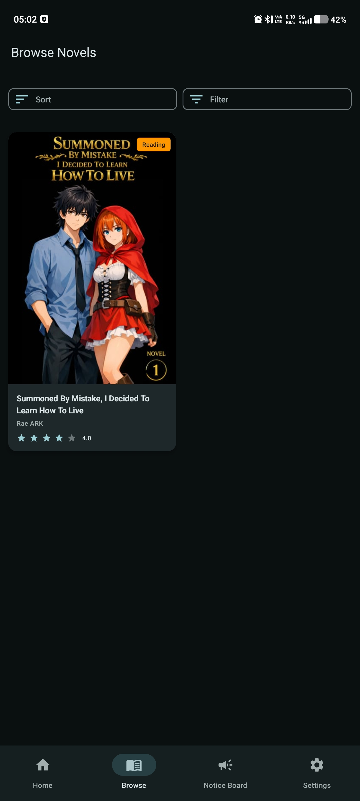

[English](../../README.md) | [简体中文](README_zh.md) | [繁體中文](README_zh-TW.md) | **日本語** | [한국어](README_ko.md) | [Türkçe](README_tr.md) | [Русский](README_ru.md) | [Tiếng Việt](README_vi.md) | [ไทย](README_th.md) | [Deutsch](README_de.md) | [Español](README_es.md) | [Français](README_fr.md) | [Українська](README_uk.md) | [Polski](README_pl.md) | [Português (Brasil)](README_pt-BR.md) | [العربية](README_ar.md) | [فارسی](README_fa.md) | [Bahasa Indonesia](README_id.md) | [Italiano](README_it.md) | [Ελληνικά](README_el.md) | [മലയാളം](README_ml.md) | [Roman Urdu](README_ur-Latn.md) | [Română](README_ro.md) | [Български](README_bg.md) | [தமிழ்](README_ta.md)

  

<h1 align="center"><b>ARKarium</b></h1>

<h4 align="center">Rae ARK が公開した小説のためのネイティブな読書体験。</h4>

  
  
  

<h4 align="center">
  <a href="/docs/foundational/what-is-arkarium.md">ARKariumとは？</a> |
  <a href="/docs">ドキュメント</a> |
  <a href="/docs/foundational">確定事項について</a>
</h4>

  
  

## 概要

ARKariumは、Rae ARKから読者への直接配信を中心に構築されています。

コンテンツはリレーにファイルとして公開され、読者のローカルライブラリに同期されます。クライアントが読書体験を担うため、恒久的なプラットフォームのバックエンドを必要としません。

<b>スクリーンショット</b>

<table>
  <tr>
    <td colspan="2">
      
    </td>
  </tr>
  <tr>
    <td colspan="2" align="center">ホーム</td>
  </tr>
  <tr>
    <td width="50%"></td>
    <td width="50%"></td>
  </tr>
  <tr>
    <td align="center">閲覧</td>
    <td align="center">作品</td>
  </tr>
  <tr>
    <td width="50%"></td>
    <td width="50%"></td>
  </tr>
  <tr>
    <td align="center">Rae ARK</td>
    <td align="center">設定</td>
  </tr>
</table>

## ハイライト

- ローカルファーストな読書体験
- Rae ARKから読者への直接配信
- 差分コンテンツ同期
- 静的コンテンツとシンプルな配信
- Androidクライアント

### 将来的な展望

- [ ] キャラクターを認識するテキスト読み上げ
- [ ] マルチボイス読み上げ
- [ ] 豊かな小説体験のための設計
- [ ] デスクトップクライアント

## インストール

ARKariumは[Obtainium](https://github.com/ImranR98/Obtainium)を通じて追跡・更新できます。

Obtainiumを使うと、中央集権的なアプリストアに頼ることなく、ソースリポジトリから直接Androidアプリをインストール・追跡できます。

**インストール方法：**

1. [Obtainium](https://github.com/ImranR98/Obtainium)をインストールします。
2. 上記の **Get it on Obtainium** バッジをクリックします。
3. ARKariumアプリの設定を確認します。
4. Obtainiumがリポジトリの更新を追跡します。

あるいは、[GitHub Releases](https://github.com/Rae-ARK/ARKarium/releases/)から最新リリースを直接ダウンロードすることもできます。

## ステータス

> [!WARNING]
> 初期開発段階。ベータ版。
>
> 現行リリース版のアプリ自体は問題なく動作し、読書に利用できます。
> V1はまだ完成していません。不具合が発生するのは通常のことです。

## ライセンス

> [!IMPORTANT]
> Copyright © 2026 Rae-ARK. All rights reserved.
>
> 本ソフトウェアおよびそのソースコードは専有物です。
>
> 著作権者の事前の書面による許可なく、本ソフトウェアまたはそのソースコードの全部または一部を複製、改変、配布、再許諾、使用することはできません。
