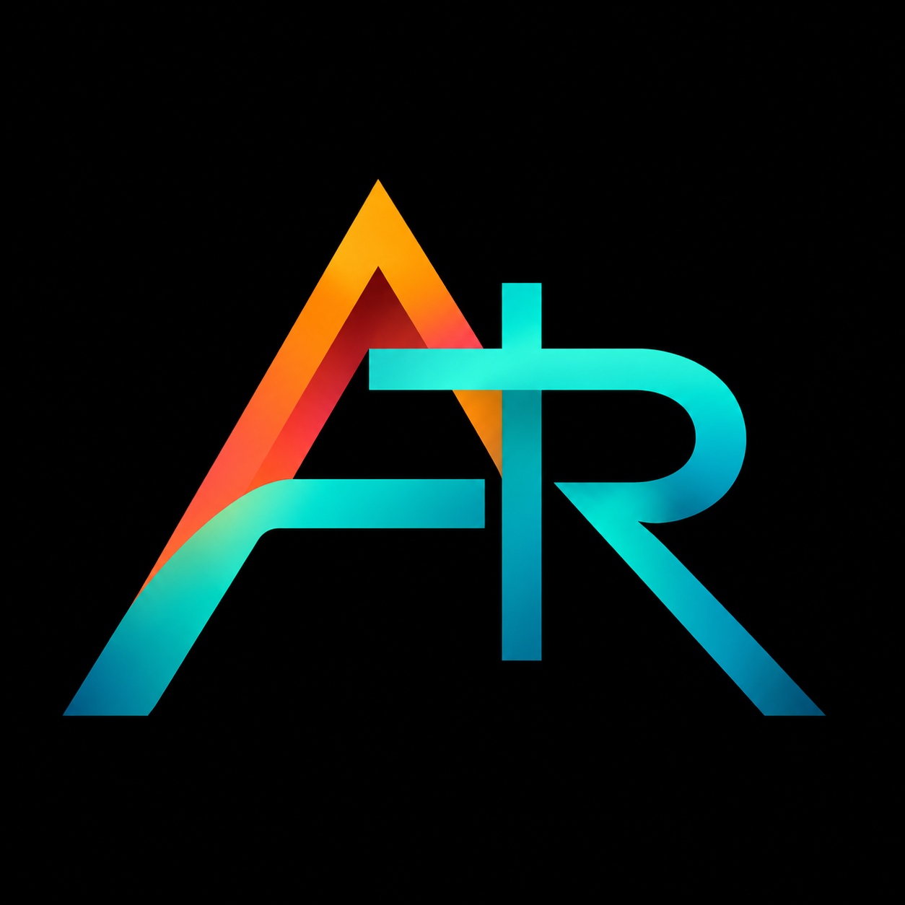

[English](../../README.md) | [简体中文](README_zh.md) | [繁體中文](README_zh-TW.md) | [日本語](README_ja.md) | [한국어](README_ko.md) | [Türkçe](README_tr.md) | [Русский](README_ru.md) | [Tiếng Việt](README_vi.md) | [ไทย](README_th.md) | [Deutsch](README_de.md) | [Español](README_es.md) | [Français](README_fr.md) | [Українська](README_uk.md) | [Polski](README_pl.md) | [Português (Brasil)](README_pt-BR.md) | [العربية](README_ar.md) | [فارسی](README_fa.md) | [Bahasa Indonesia](README_id.md) | [Italiano](README_it.md) | [Ελληνικά](README_el.md) | [മലയാളം](README_ml.md) | [Roman Urdu](README_ur-Latn.md) | [Română](README_ro.md) | [Български](README_bg.md) | **தமிழ்**

  

<h1 align="center"><b>ARKarium</b></h1>

<h4 align="center">Rae ARK வெளியிட்ட புனைகதைகளுக்கான ஒரு native வாசிப்பு அனுபவம்.</h4>

  
  
  

<h4 align="center">
  <a href="/docs/foundational/what-is-arkarium.md">ARKarium என்றால் என்ன?</a> |
  <a href="/docs">ஆவணப்படுத்தல்</a> |
  <a href="/docs/foundational">உறுதி செய்யப்பட்ட முடிவுகள்</a>
</h4>

  
  

## இது என்ன

Rae ARK இடமிருந்து வாசகருக்கு நேரடி விநியோகத்தை மையமாகக் கொண்டு ARKarium உருவாக்கப்பட்டுள்ளது.

உள்ளடக்கம் ஒரு relay-இல் கோப்புகளாக வெளியிடப்பட்டு, வாசகரின் உள்ளூர் நூலகத்துடன் ஒத்திசைக்கப்படுகிறது. நிரந்தரமான platform backend தேவைப்படாமல், client தானே வாசிப்பு அனுபவத்தை கையாளுகிறது.

<b>திரைப்படங்கள்</b>

<table>
  <tr>
    <td colspan="2">
      
    </td>
  </tr>
  <tr>
    <td colspan="2" align="center">முகப்பு</td>
  </tr>
  <tr>
    <td width="50%"></td>
    <td width="50%"></td>
  </tr>
  <tr>
    <td align="center">உலாவு</td>
    <td align="center">புனைகதைகள்</td>
  </tr>
  <tr>
    <td width="50%"></td>
    <td width="50%"></td>
  </tr>
  <tr>
    <td align="center">Rae ARK</td>
    <td align="center">அமைப்புகள்</td>
  </tr>
</table>

## சிறப்பம்சங்கள்

- Local-first வாசிப்பு
- Rae ARK இடமிருந்து வாசகர்களுக்கு நேரடி விநியோகம்
- படிப்படியான உள்ளடக்க ஒத்திசைவு
- நிலையான உள்ளடக்கமும் எளிய விநியோகமும்
- Android கிளையன்ட்

### எதிர்காலத்தில்

- [ ] கதாபாத்திரங்களை அறியும் text-to-speech
- [ ] பல குரல்களில் வாசிப்பு
- [ ] வளமான புனைகதை அனுபவத்திற்காக வடிவமைக்கப்பட்டது
- [ ] Desktop கிளையன்ட்

## நிறுவுதல்

[Obtainium](https://github.com/ImranR98/Obtainium) மூலம் ARKarium-ஐ கண்காணித்து புதுப்பிக்க முடியும்.

ஒரு மைய பயன்பாட்டு கடைக்கு சார்பில்லாமல், மூலக் களஞ்சியங்களிலிருந்து நேரடியாக Android பயன்பாடுகளை நிறுவவும் கண்காணிக்கவும் Obtainium பயனர்களை அனுமதிக்கிறது.

**நிறுவ:**

1. [Obtainium](https://github.com/ImranR98/Obtainium)-ஐ நிறுவவும்.
2. மேலே உள்ள **Get it on Obtainium** பேட்ஜைக் கிளிக் செய்யவும்.
3. ARKarium பயன்பாட்டு உள்ளமைவை உறுதிப்படுத்தவும்.
4. கிடைக்கும் புதுப்பிப்புகளுக்காக Obtainium களஞ்சியத்தை கண்காணிக்கும்.

மாற்றாக, [GitHub Releases](https://github.com/Rae-ARK/ARKarium/releases/) இலிருந்து நேரடியாக சமீபத்திய வெளியீட்டை பதிவிறக்கவும்.

## நிலை

> [!WARNING]
> ஆரம்ப வளர்ச்சி கட்டம். பீட்டா கட்டம்.
>
> தற்போதைய வெளியீட்டு பயன்பாடு சரியாக இயங்குகிறது, மேலும் வாசிப்பதற்குப் பயன்படுத்தலாம்.
> V1 இன்னும் முடிக்கப்படவில்லை. பிழைகள் இயல்பானவை.

## உரிமம்

> [!IMPORTANT]
> பதிப்புரிமை © 2026 Rae-ARK. அனைத்து உரிமைகளும் பாதுகாக்கப்பட்டவை.
>
> இந்த மென்பொருளும் அதன் மூலக் குறியீடும் தனியுரிமையானவை (proprietary).
>
> பதிப்புரிமை உரிமையாளரின் முன் எழுத்துப்பூர்வ அனுமதியின்றி, இந்த மென்பொருளையோ அதன் மூலக் குறியீட்டையோ முழுமையாகவோ பகுதியாகவோ நகலெடுக்க, மாற்ற, விநியோகிக்க, துணை உரிமம் வழங்க அல்லது பயன்படுத்த அனுமதி இல்லை.
