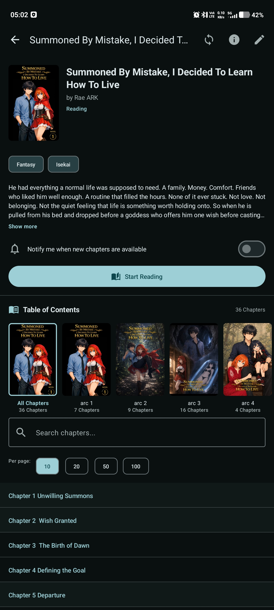

[English](../../README.md) | [简体中文](README_zh.md) | [繁體中文](README_zh-TW.md) | [日本語](README_ja.md) | [한국어](README_ko.md) | **Türkçe** | [Русский](README_ru.md) | [Tiếng Việt](README_vi.md) | [ไทย](README_th.md) | [Deutsch](README_de.md) | [Español](README_es.md) | [Français](README_fr.md) | [Українська](README_uk.md) | [Polski](README_pl.md) | [Português (Brasil)](README_pt-BR.md) | [العربية](README_ar.md) | [فارسی](README_fa.md) | [Bahasa Indonesia](README_id.md) | [Italiano](README_it.md) | [Ελληνικά](README_el.md) | [മലയാളം](README_ml.md) | [Roman Urdu](README_ur-Latn.md) | [Română](README_ro.md) | [Български](README_bg.md) | [தமிழ்](README_ta.md)

  

<h1 align="center"><b>ARKarium</b></h1>

<h4 align="center">Rae ARK'ın yayımladığı kurgular için yerel bir okuma deneyimi.</h4>

  
  
  
  

<h4 align="center">
  <a href="/docs/foundational/what-is-arkarium.md">ARKarium nedir?</a> |
  <a href="/docs">Dokümantasyon</a> |
  <a href="/docs/foundational">Kesinleşmiş Kararlar</a>
</h4>

  
  

## Nedir

ARKarium, Rae ARK'tan okuyucusuna doğrudan dağıtım etrafında inşa edilmiştir.

İçerik bir röleye dosyalar olarak yayımlanır ve okuyucunun yerel kitaplığına senkronize edilir. İstemci, kalıcı bir platform arka ucuna ihtiyaç duymak yerine okuma deneyimini kendisi yönetir.

<b>Ekran Görüntüleri</b>

<table>
  <tr>
    <td colspan="2">
      
    </td>
  </tr>
  <tr>
    <td colspan="2" align="center">Ana Sayfa</td>
  </tr>
  <tr>
    <td width="50%"></td>
    <td width="50%"></td>
  </tr>
  <tr>
    <td align="center">Gözat</td>
    <td align="center">Kurgular</td>
  </tr>
  <tr>
    <td width="50%"></td>
    <td width="50%"></td>
  </tr>
  <tr>
    <td align="center">Rae ARK</td>
    <td align="center">Ayarlar</td>
  </tr>
</table>

## Öne Çıkanlar

- Yerelden önce okuma
- Rae ARK'tan okuyuculara doğrudan dağıtım
- Artımlı içerik senkronizasyonu
- Statik içerik ve basit dağıtım
- Android istemcisi

### Gelecekte

- [ ] Karakter farkındalıklı metinden sese dönüştürme
- [ ] Çoklu seslendirmeli okuma
- [ ] Zengin bir kurgu deneyimi için tasarlandı
- [ ] Masaüstü istemcisi

## Kurulum

ARKarium, [Obtainium](https://github.com/ImranR98/Obtainium) aracılığıyla takip edilip güncellenebilir.

Obtainium, kullanıcıların Android uygulamalarını merkezi bir uygulama mağazasına bağımlı kalmadan doğrudan kaynak depolarından yüklemesine ve takip etmesine olanak tanır.

**Kurulmak için:**

1. [Obtainium](https://github.com/ImranR98/Obtainium)'u yükleyin.
2. Yukarıdaki **Get it on Obtainium** rozetine tıklayın.
3. ARKarium uygulama yapılandırmasını onaylayın.
4. Obtainium, depoyu mevcut güncellemeler için takip edecektir.

Alternatif olarak, en son sürümü doğrudan [GitHub Releases](https://github.com/Rae-ARK/ARKarium/releases/) üzerinden indirebilirsiniz.

## Durum

> [!WARNING]
> Erken geliştirme aşaması. Beta sürümü.
>
> Mevcut sürüm uygulaması kendi başına sorunsuz çalışıyor ve okuma için kullanılabilir.
> V1 henüz tamamlanmadı. Hatalarla karşılaşmak normaldir.
>
> Uygulama ve romanlar şimdilik İngilizce. 
> Daha fazla dil mi? Belki ileride. 
> Okuyucu talebine bağlı. 
>
> Belki bir ya da iki düzgün çeviri olur. Diğerleri muhtemelen makine çevirisi (MTL) olarak kalır. 

## Lisans

> [!IMPORTANT]
> Telif Hakkı © 2026 Rae-ARK. Tüm hakları saklıdır.
>
> Bu yazılım ve kaynak kodu mülkiyete tabidir (proprietary).
>
> Telif hakkı sahibinin önceden yazılı izni olmadan bu yazılımın veya kaynak kodunun tamamının veya bir kısmının kopyalanmasına, değiştirilmesine, dağıtılmasına, alt lisanslanmasına veya kullanılmasına izin verilmez.
