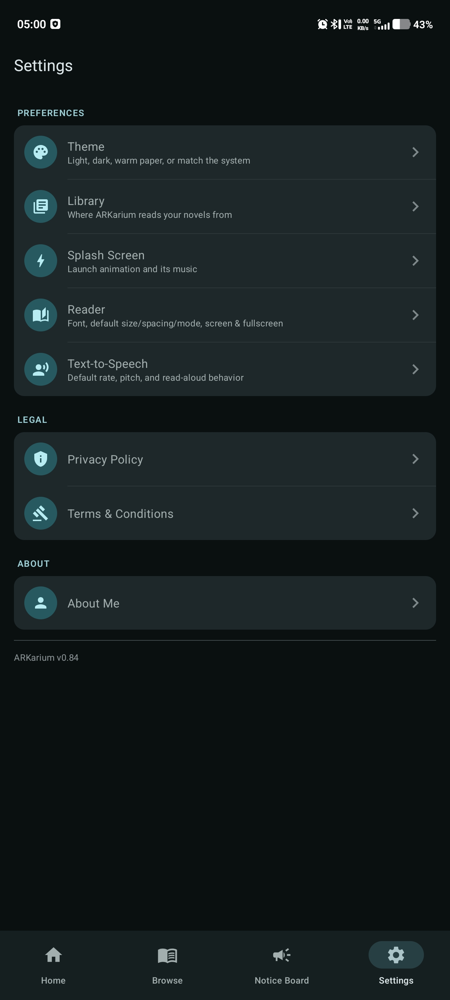

[English](../../README.md) | [简体中文](README_zh.md) | [繁體中文](README_zh-TW.md) | [日本語](README_ja.md) | [한국어](README_ko.md) | [Türkçe](README_tr.md) | [Русский](README_ru.md) | [Tiếng Việt](README_vi.md) | [ไทย](README_th.md) | [Deutsch](README_de.md) | [Español](README_es.md) | [Français](README_fr.md) | [Українська](README_uk.md) | [Polski](README_pl.md) | [Português (Brasil)](README_pt-BR.md) | [العربية](README_ar.md) | [فارسی](README_fa.md) | [Bahasa Indonesia](README_id.md) | [Italiano](README_it.md) | [Ελληνικά](README_el.md) | [മലയാളം](README_ml.md) | **Roman Urdu** | [Română](README_ro.md) | [Български](README_bg.md) | [வாசிப்புக்குறிப்பு](README_ta.md)

  

<h1 align="center"><b>ARKarium</b></h1>

<h4 align="center">Rae ARK ki shaya shuda fiction ke liye aik native reading experience.</h4>

  
  
  

<h4 align="center">
  <a href="/docs/foundational/what-is-arkarium.md">ARKarium kya hai?</a> |
  <a href="/docs">Dastawezat (Documentation)</a> |
  <a href="/docs/foundational">Tay Shuda Faislay</a>
</h4>

  
  

## Yeh kya hai

ARKarium, Rae ARK se qari tak direct distribution ke gird bana gaya hai.

Content ek relay par files ki surat mein publish hota hai aur qari ki local library ke sath sync ho jata hai. Client khud reading experience ko handle karta hai, is liye kisi permanent platform backend ki zaroorat nahi parti.

<b>Screenshots</b>

<table>
  <tr>
    <td colspan="2">
      
    </td>
  </tr>
  <tr>
    <td colspan="2" align="center">Home</td>
  </tr>
  <tr>
    <td width="50%"></td>
    <td width="50%"></td>
  </tr>
  <tr>
    <td align="center">Browse</td>
    <td align="center">Fictions</td>
  </tr>
  <tr>
    <td width="50%"></td>
    <td width="50%"></td>
  </tr>
  <tr>
    <td align="center">Rae ARK</td>
    <td align="center">Settings</td>
  </tr>
</table>

## Khas Baatein

- Local-first reading
- Rae ARK se qareen tak direct distribution
- Incremental content synchronization
- Static content aur simple distribution
- Android client

### Mustaqbil Mein

- [ ] Character-aware text-to-speech
- [ ] Multi-voice reading
- [ ] Rich fiction experience ke liye design kiya gaya
- [ ] Desktop client

## Installation

ARKarium ko [Obtainium](https://github.com/ImranR98/Obtainium) ke zariye track aur update kiya ja sakta hai.

Obtainium users ko apne source repositories se seedha Android applications install aur track karne deta hai, bina kisi centralized app store par inhisar kiye.

**Install karne ke liye:**

1. [Obtainium](https://github.com/ImranR98/Obtainium) install karein.
2. Upar diye gaye **Get it on Obtainium** badge par click karein.
3. ARKarium application configuration confirm karein.
4. Obtainium repository ko available updates ke liye track karta rahega.

Ya phir, latest release seedha [GitHub Releases](https://github.com/Rae-ARK/ARKarium/releases/) se download karein.

## Status

> [!WARNING]
> Early development. Beta stage.
>
> Current release app theek tarah kaam karta hai, aur isay reading ke liye istemal kiya ja sakta hai.
> V1 abhi mukammal nahi hua. Bugs ka milna normal baat hai.

## License

> [!IMPORTANT]
> Copyright © 2026 Rae-ARK. Tamam huqooq mehfooz hain.
>
> Yeh software aur iska source code proprietary hai.
>
> Copyright holder ki pehle se tehreeri ijazat ke baghair, is software ya iske source code ko, mukammal ya kisi hisse mein, copy, modify, distribute, sub-license ya istemal karne ki ijazat nahi di jati.
