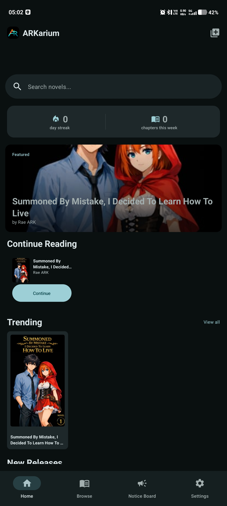

[English](../../README.md) | **简体中文** | [繁體中文](README_zh-TW.md) | [日本語](README_ja.md) | [한국어](README_ko.md) | [Türkçe](README_tr.md) | [Русский](README_ru.md) | [Tiếng Việt](README_vi.md) | [ไทย](README_th.md) | [Deutsch](README_de.md) | [Español](README_es.md) | [Français](README_fr.md) | [Українська](README_uk.md) | [Polski](README_pl.md) | [Português (Brasil)](README_pt-BR.md) | [العربية](README_ar.md) | [فارسی](README_fa.md) | [Bahasa Indonesia](README_id.md) | [Italiano](README_it.md) | [Ελληνικά](README_el.md) | [മലയാളം](README_ml.md) | [Roman Urdu](README_ur-Latn.md) | [Română](README_ro.md) | [Български](README_bg.md) | [வாசிப்புக்குறிப்பு](README_ta.md)

  

<h1 align="center"><b>ARKarium</b></h1>

<h4 align="center">为 Rae ARK 已发布的小说打造的原生阅读体验。</h4>

  
  
  

<h4 align="center">
  <a href="/docs/foundational/what-is-arkarium.md">什么是 ARKarium？</a> |
  <a href="/docs">文档</a> |
  <a href="/docs/foundational">既定决策</a>
</h4>

  
  

## 简介

ARKarium 的核心是从 Rae ARK 直接分发给读者。

内容以文件形式发布到中继服务器，并同步到读者的本地书库。客户端负责处理阅读体验，而不需要依赖永久性的平台后端。

<b>截图</b>

<table>
  <tr>
    <td colspan="2">
      
    </td>
  </tr>
  <tr>
    <td colspan="2" align="center">主页</td>
  </tr>
  <tr>
    <td width="50%"></td>
    <td width="50%"></td>
  </tr>
  <tr>
    <td align="center">浏览</td>
    <td align="center">小说</td>
  </tr>
  <tr>
    <td width="50%"></td>
    <td width="50%"></td>
  </tr>
  <tr>
    <td align="center">Rae ARK</td>
    <td align="center">设置</td>
  </tr>
</table>

## 亮点

- 本地优先阅读
- Rae ARK 直接面向读者分发
- 增量内容同步
- 静态内容与简单分发
- Android 客户端

### 未来展望

- [ ] 具备角色识别的文本转语音
- [ ] 多声线朗读
- [ ] 为丰富的小说体验而设计
- [ ] 桌面客户端

## 安装

ARKarium 可通过 [Obtainium](https://github.com/ImranR98/Obtainium) 进行追踪和更新。

Obtainium 允许用户直接从源代码仓库安装和追踪 Android 应用，而无需依赖中心化的应用商店。

**安装步骤：**

1. 安装 [Obtainium](https://github.com/ImranR98/Obtainium)。
2. 点击上方的 **Get it on Obtainium** 徽章。
3. 确认 ARKarium 应用配置。
4. Obtainium 将持续追踪该仓库的可用更新。

或者，直接从 [GitHub Releases](https://github.com/Rae-ARK/ARKarium/releases/) 下载最新版本。

## 状态

> [!WARNING]
> 早期开发阶段，测试版。
>
> 当前发布的应用本身运行良好，可以正常用于阅读。
> V1 版本尚未完成，出现问题属于正常现象。

## 许可

> [!IMPORTANT]
> 版权所有 © 2026 Rae-ARK。保留所有权利。
>
> 本软件及其源代码为专有财产。
>
> 未经版权所有者事先书面许可，不得复制、修改、分发、再许可或使用本软件或其源代码的全部或部分内容。
